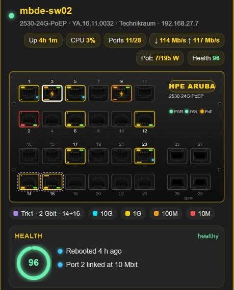

<p align="center">
  
</p>

<h1 align="center">Backplane</h1>

<p align="center">
  <b>Your network switch, live in Home Assistant.</b><br>
  Front-panel view with link speed, live traffic, PoE, LACP trunks and LLDP neighbours - straight from SNMP.
</p>

<p align="center">
  <a href="https://github.com/hacs/integration"></a>
  
  
</p>

<p align="center">
  
</p>

## Features

- **Front panel** - every port drawn like the real switch (odd/even rows, SFP cage), link LED coloured by speed (10M / 100M / 1G / 10G), activity LED blinking with real traffic, utilisation bar per port
- **PoE** - budget bar, powered ports with a bolt icon and per-port watts (HP/Aruba ProCurve)
- **Trunks** - static and LACP trunks (ifStackTable) highlighted around their member ports
- **LLDP** - neighbours per port (name and remote port), shown on the panel and in a list
- **Hardware health** - power supply / fan status (HP/Aruba ProCurve)
- **Traffic chart** - last 60 minutes of switched traffic, seeded from the recorder
- **Port details** - tap a port: speed, in/out, utilisation, errors, VLAN, PoE, trunk, neighbour
- **Phone friendly** - the panel splits into two rows on narrow screens
- **No dependencies** - Backplane ships its own tiny async SNMP v2c client (GET/GETBULK). No pysnmp, no blocking MIB loading, small UDP packets that also work over VPN tunnels
- **UI setup** - add a switch with IP and community, nothing in YAML

Tested with HP J9773A 2530-24G-PoEP (YA.16.11) and an OpenWrt router (Xiaomi AX3000T, net-snmp). Any device with IF-MIB works; PoE, LLDP and Q-BRIDGE data are used when the device provides them.

- **Routers / OpenWrt** - bridges, Wi-Fi, VPN and VLAN sub-interfaces are hidden automatically, the WAN port is highlighted and small devices get a single-row panel. CPU comes from HOST-RESOURCES-MIB.

<p align="center"></p>

## Installation

### HACS (custom repository)

[](https://my.home-assistant.io/redirect/hacs_repository/?owner=mb26-dev&repository=ha-backplane&category=integration)

1. HACS → ⋮ → **Custom repositories** → add `https://github.com/mb26-dev/ha-backplane`, type **Integration**.
2. Install **Backplane** and restart Home Assistant.
3. **Settings → Devices & services → Add integration → Backplane**.

### Manual

Copy `custom_components/backplane` into your `config/custom_components/` folder and restart Home Assistant.

## Switch preparation

Enable SNMP v2c with a **read-only** community. Example for HP/Aruba ProCurve:

```
configure terminal
snmp-server community "your-ro-community" operator restricted
write memory
```

Avoid leaving the factory `public` community with manager (write) rights enabled.

## Setup

**Settings → Devices & services → Add integration → Backplane**, then enter:

| Field | Description |
|---|---|
| Host | IP or hostname of the switch |
| SNMP community | read-only community |
| SNMP port | default 161 |
| Display name | optional, otherwise the switch's sysName |

Options: polling interval (default 30 s, 10-600 s) and an optional port filter (regular expression on the interface name, e.g. `^(wan|lan\d+)$`; empty = auto). Interface names, trunks, LLDP neighbours and VLANs are re-read every 10 minutes.

## Entities

| Entity | Description |
|---|---|
| `sensor.<switch>_backplane` | Ports up; attributes carry the full port map for the card (not stored in the recorder) |
| `sensor.<switch>_traffic_in` / `_traffic_out` | Total switched traffic in Mbit/s |
| `sensor.<switch>_ports_up` | Ports with link |
| `sensor.<switch>_cpu` | CPU load (HP/Aruba) |
| `sensor.<switch>_poe_power` / `_poe_budget` | PoE consumption and budget |
| `sensor.<switch>_last_boot` | Boot time |
| `binary_sensor.<switch>_power_supply` / `_fan` | Hardware problem (HP/Aruba) |

## Card

The card is bundled with the integration and loaded automatically - no extra resource needed.

```yaml
type: custom:backplane-card
entities:
  - sensor.core_switch_backplane
  - sensor.rack_switch_backplane
```

| Option | Description |
|---|---|
| `entity` / `entities` | one or more `sensor.*_backplane` entities |
| `sfp_ports` | number of SFP ports at the end (auto: 4 for 28/52-port switches) |

Per entry in `entities` you can also set `name`, `sfp_ports`, `brand` and `model` (panel labels):

```yaml
type: custom:backplane-card
entities:
  - entity: sensor.core_switch_backplane
    name: Core switch
    sfp_ports: 4
  - entity: sensor.router_backplane
    name: Router
    brand: Xiaomi
    model: AX3000T · OpenWrt
```

### OpenWrt

```
apk add snmpd        # OpenWrt 25.x (opkg install snmpd on 24.x)
/etc/init.d/snmpd enable && /etc/init.d/snmpd start
```

## Support

If Backplane is useful to you, you can support the work on [Ko-fi](https://ko-fi.com/mb26dev).

## License

MIT
