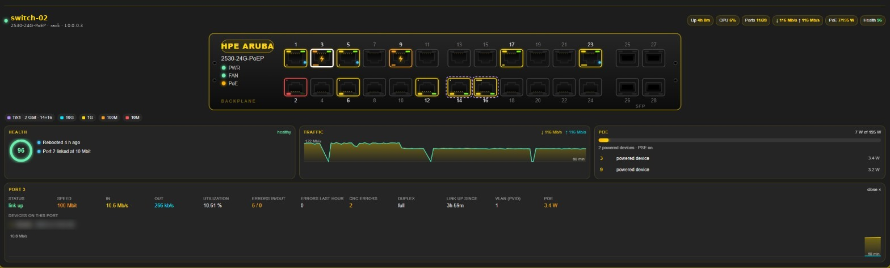

<p align="center">
  
</p>

<h1 align="center">Backplane</h1>

<p align="center">
  <b>Your network switch, live in Home Assistant.</b><br>
  Front-panel view with link speed, live traffic, PoE, LACP trunks and LLDP neighbours - straight from SNMP.
</p>

<p align="center">
  <a href="https://github.com/hacs/integration"></a>
  
  
</p>

<p align="center">
  
</p>

## Features

- **Front panel** - every port drawn like the real switch (odd/even rows, SFP cage), link LED coloured by speed (10M / 100M / 1G / 10G), activity LED blinking with real traffic, utilisation bar per port
- **PoE** - budget bar, powered ports with a bolt icon and per-port watts (HP/Aruba ProCurve)
- **Trunks** - static and LACP trunks (ifStackTable) highlighted around their member ports
- **LLDP** - neighbours per port (name and remote port), shown on the panel and in a list
- **Who is on which port** - the switch MAC table is matched with the devices Home Assistant already knows (and with the ARP table of a router), so a port shows *omv-qnap* instead of just *1 Gbit*
- **Topology** - devices in one card that see each other via LLDP are connected with an animated link line (ports, speed, live traffic)
- **Health score** - 0-100 per device with findings: hardware failures, PoE budget, rising error/CRC counters, flapping ports, half duplex, degraded trunks, high CPU, recent reboots
- **Health report** - `backplane.health_report` returns an e-mail ready HTML report (plus plain text and structured findings)
- **Hardware health** - power supply / fan status (HP/Aruba ProCurve)
- **Traffic chart** - last 60 minutes of switched traffic, seeded from the recorder
- **Port details** - tap a port: speed, in/out, utilisation, errors, VLAN, PoE, trunk, neighbour
- **Phone friendly** - the panel splits into two rows on narrow screens
- **SNMP v2c and v3** - own async SNMP client (GET/GETBULK, USM with MD5/SHA/SHA-256 and AES-128/DES). No pysnmp, no blocking MIB loading, small UDP packets that also work over VPN tunnels
- **Automations** - `backplane_port_event` on link up/down and speed change, optional link entity per port
- **UI setup and reconfigure** - add a device with IP and community or v3 user; change connection settings later without deleting it; diagnostics download with secrets redacted
- **UI setup** - add a switch with IP and community, nothing in YAML

Tested with HP J9773A 2530-24G-PoEP (YA.16.11) and an OpenWrt router (Xiaomi AX3000T, net-snmp). Any device with IF-MIB works; PoE, LLDP and Q-BRIDGE data are used when the device provides them.

- **Routers / OpenWrt** - bridges, Wi-Fi, VPN and VLAN sub-interfaces are hidden automatically, the WAN port is highlighted and small devices get a single-row panel. CPU comes from HOST-RESOURCES-MIB.

<p align="center"></p>

## Installation

### HACS (recommended)

[](https://my.home-assistant.io/redirect/hacs_repository/?owner=mb26-dev&repository=ha-backplane&category=integration)

1. Open **HACS** in Home Assistant, search for **Backplane** and install it.
2. Restart Home Assistant.
3. **Settings → Devices & services → Add integration → Backplane**.

<details>
<summary>Not showing up in HACS yet? Add it as a custom repository</summary>

1. HACS → ⋮ → **Custom repositories** → add `https://github.com/mb26-dev/ha-backplane`, type **Integration**.
2. Install **Backplane** and restart Home Assistant.

</details>

### Manual

Copy `custom_components/backplane` into your `config/custom_components/` folder and restart Home Assistant.

## Switch preparation

Enable SNMP with **read-only** access. Examples for HP/Aruba ProCurve:

SNMP v2c:
```
configure terminal
snmp-server community "your-ro-community" operator restricted
write memory
```

SNMP v3 (recommended):
```
configure terminal
snmpv3 enable
snmpv3 user "backplane" auth sha "auth-password" priv aes "priv-password"
snmpv3 group operatorauth user "backplane" sec-model ver3
write memory
```

Avoid leaving the factory `public` community with manager (write) rights enabled.

## Setup

**Settings → Devices & services → Add integration → Backplane**, then enter:

| Field | Description |
|---|---|
| Host | IP or hostname of the switch |
| SNMP port | default 161 |
| SNMP version | v2c or v3 |
| Community | v2c read-only community |
| User / auth / privacy | v3 user, auth protocol (MD5, SHA-1, SHA-256) and password, privacy protocol (AES-128, DES, none) and password |
| Display name | optional, otherwise the switch's sysName |

Connection settings can be changed later with **⋮ → Reconfigure** on the device's integration entry.

Options: polling interval (default 30 s, 10-600 s), port events on/off and an optional port filter (regular expression on the interface name, e.g. `^(wan|lan\d+)$`; empty = auto). Interface names, trunks, LLDP neighbours and VLANs are re-read every 10 minutes.

## Entities

| Entity | Description |
|---|---|
| `sensor.<switch>_backplane` | Ports up; attributes carry the full port map for the card (not stored in the recorder) |
| `sensor.<switch>_traffic_in` / `_traffic_out` | Total switched traffic in Mbit/s |
| `sensor.<switch>_ports_up` | Ports with link |
| `sensor.<switch>_cpu` | CPU load (HP/Aruba) |
| `sensor.<switch>_poe_power` / `_poe_budget` | PoE consumption and budget |
| `sensor.<switch>_last_boot` | Boot time |
| `sensor.<switch>_health` | Health score 0-100, attributes `grade`, `findings` |
| `binary_sensor.<switch>_health_problem` | On when there is a warning or critical finding |
| `binary_sensor.<switch>_power_supply` / `_fan` | Hardware problem (HP/Aruba) |
| `binary_sensor.<switch>_port_<n>_link` | Link state per port with speed, traffic, devices (disabled by default) |

### Port events

`backplane_port_event` with `device`, `host`, `port`, `event` (`link_up`, `link_down`, `speed_change` + `old`/`new`):

```yaml
triggers:
  - trigger: event
    event_type: backplane_port_event
    event_data:
      device: core-switch
      port: "14"
      event: link_down
```

## Health report

`backplane.health_report` evaluates all Backplane devices and returns `html`, `text` and `devices` (score, grade, findings). Example - weekly report by e-mail:

```yaml
alias: Backplane weekly health report
triggers:
  - trigger: time
    at: "08:00:00"
conditions:
  - condition: time
    weekday: mon
actions:
  - action: backplane.health_report
    response_variable: report
  - action: notify.send_message
    target:
      entity_id: notify.my_mail
    data:
      title: Switch Health Report
      message: "{{ report.text }}"
```

For an HTML mail use the SMTP integration's legacy notify action (`notify.<smtp_name>`) with `data: {html: "{{ report.html }}"}`.

Findings and thresholds:

| Level | Finding |
|---|---|
| critical | power supply / fan failure, PoE budget > 95 %, > 500 errors per hour on a port, trunk down |
| warning | PoE budget > 80 %, ≥ 10 errors per hour (incl. CRC), ≥ 3 link changes per hour, half duplex, trunk member down, CPU ≥ 80 % |
| info | reboot within 24 h, 10 Mbit link |

## Card

The card is bundled with the integration and loaded automatically - no extra resource needed.

```yaml
type: custom:backplane-card
entities:
  - sensor.core_switch_backplane
  - sensor.rack_switch_backplane
```

| Option | Description |
|---|---|
| `entity` / `entities` | one or more `sensor.*_backplane` entities |
| `sfp_ports` | number of SFP ports at the end (auto: 4 for 28/52-port switches) |
| `topology` | `false` hides the link diagram between devices |

The card has a visual editor (device picker).

Per entry in `entities` you can also set `name`, `sfp_ports`, `port_names` (e.g. `{"14": "NAS"}`), `brand`, `model` (panel labels) and `logo` (image URL, e.g. `/local/logos/vendor.png`, shown on the panel instead of the brand text):

```yaml
type: custom:backplane-card
entities:
  - entity: sensor.core_switch_backplane
    name: Core switch
    sfp_ports: 4
  - entity: sensor.router_backplane
    name: Router
    brand: Xiaomi
    model: AX3000T · OpenWrt
```

### OpenWrt

```
apk add snmpd        # OpenWrt 25.x (opkg install snmpd on 24.x)
/etc/init.d/snmpd enable && /etc/init.d/snmpd start
```

## Support

If Backplane is useful to you, you can support the work on [Ko-fi](https://ko-fi.com/mb26dev).

## License

MIT
